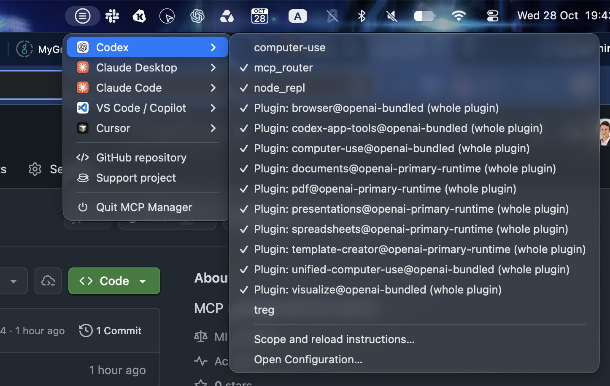

# macOS MCP Manager

A macOS menu bar app for switching MCP configurations per AI client.



```text
MCP
├── Codex
│   ├── ✓ github
│   └──   notion
├── Claude Desktop
│   └── ✓ filesystem
├── Claude Code
├── VS Code / Copilot
├── Cursor
├── GitHub repository
├── Support project
└── Quit MCP Manager
```

Click a server to switch its configuration. Each client submenu includes reload instructions; it never quits clients, starts MCP servers, or interrupts sessions. It polls the small set of configuration files every two seconds and updates the menu when they change. Unconfigured clients remain visible with an explanatory message.

## Build and run

Requires macOS 14+, a current stable Rust toolchain, and Xcode Command Line Tools.

```sh
make run
```

A circle containing three horizontal lines appears in the menu bar, with no Dock icon or application window. The icon uses a macOS template image to adapt to light and dark appearances. To create an app bundle:

```sh
make build
open "dist/MCP Manager.app"
```

Move the bundle to `/Applications` to install it. Packaging signs ad hoc by default for local use. Set `SIGNING_IDENTITY` to a Developer ID identity for signing; notarization is a separate release step. No notarization credentials are required for development.

Inspect configured names and states without launching the menu:

```sh
cargo run --locked -- --list
```

Quit the app first: all modes share a single-instance lock to protect state. Output excludes server commands, environment variables, URLs, and credentials. Names and configuration paths are included.

## Client support

This initial release manages **user-level configuration only**. Checkmarks describe local configuration, not live server connectivity or effective permissions after project/organization overrides.

| Client | Configuration | Behavior |
| --- | --- | --- |
| Codex | `~/.codex/config.toml` (honors `CODEX_HOME`) | Toggles native `mcp_servers.<name>.enabled`. Also exposes whole-plugin toggles for existing `plugins` entries and individual server policies already listed under a plugin. |
| Claude Desktop | `~/Library/Application Support/Claude/claude_desktop_config.json` | Moves a disabled `mcpServers` definition to the app's private recovery state; restores it when enabled. Fully restart Claude Desktop. |
| Claude Code | `~/.claude.json` | Sets aside user `mcpServers` definitions globally, preserving project settings. Start a new session. This is distinct from Claude Code's native per-project `/mcp` toggles. |
| VS Code / Copilot | `~/Library/Application Support/Code/User/mcp.json` | Sets aside/restores `servers` definitions. **Checkmarks mean configuration present.** VS Code's separate native enablement state is not read or changed. Reload the window, and use VS Code's own Enable action if needed. |
| Cursor | `~/.cursor/mcp.json` | Sets aside/restores user `mcpServers` definitions. Reload MCP or restart Cursor. |

Whole-plugin toggles in Codex affect the entire plugin, including skills and hooks; the menu explicitly labels them. A server belonging to a disabled parent plugin is not independently toggleable. Installed plugins absent from user configuration are not discovered by scanning caches. Individual bundled server definitions absent from user policy are not inferred.

Not included: regular ChatGPT cloud connectors, Claude extensions/cloud connectors, project configurations, VS Code profiles and remote hosts, managed policies, custom Claude configuration directories, or runtime status. Codex CLI, desktop, and IDE integrations can share configuration, so they are not independent toggles. Use the clients' own interfaces for these cases.

## Configuration integrity

- TOML edits preserve comments and unrelated settings using `toml_edit`.
- JSON/JSONC edits use a concrete syntax tree, preserving unrelated comments and values. Set-aside definitions retain their raw value, including nested comments. Re-enabling can change a definition's position/indentation.
- Configuration writes use a temporary file in the same directory followed by atomic replacement, retaining ordinary file permissions. Symlinks are resolved and the link itself remains intact. Hard-linked configurations are refused.
- Every change first saves a durable recovery journal. Recovery completes or cancels interrupted changes only when the configuration matches the saved before/after bytes.
- A stale menu refuses to overwrite newer external edits. This is a best-effort compare-before-replace check: other applications do not share our lock, so it cannot provide an OS-level compare-and-swap guarantee.
- Duplicate keys, malformed files, invalid enablement values, and restoration name conflicts block changes rather than guessing.
- The app holds a single-instance lock. Configuration values and credentials are never intentionally logged or included in `--list` output. Parser errors are sanitized.

App data lives in `~/Library/Application Support/MCP Manager` (directory mode `0700`; files `0600`). **It contains plaintext copies of configurations and credentials**, just as client configuration files can. Keep this folder private. Its `state.json` contains disabled definitions and, while a save is in progress, its recovery journal. This file is not encrypted or synced by the app. There is no retained undo history or separate backup file.

**Re-enable servers before removing the app or deleting its data.** Set-aside definitions remain absent from their clients until restored. See [recovery instructions](docs/recovery.md).

The menu contains clients, GitHub repository, Support project, and Quit. Client entries use the installed applications’ own icons in their original colors (both Claude entries share the Claude logo). If an app is unavailable, its entry falls back to a macOS system symbol. The project links and Quit use system symbols that adapt to light and dark appearances. GitHub repository opens the [source repository](https://github.com/yurist38/macos-mcp-manager), and Support project opens [Buy Me a Coffee](https://buymeacoffee.com/roomjs), both in your default browser. Changes refresh automatically; there are no manual refresh, status, undo, recovery-folder, or launch-at-login controls. Older state files are readable, including disabled definitions and pending writes; obsolete undo data is ignored. If you enabled Launch at Login in an older build, remove `~/Library/LaunchAgents/dev.mcp-manager.plist` to stop that existing login item.

## Development and verification

```sh
make lint
make test
```

Run `make` or `make help` to list the main commands. `make lint` checks formatting and runs Clippy; `make test` runs the tests; `make build` creates and signs the release app bundle. Use `make fmt` to format the source and `make run` to start the development app. CI uses the same lint, test, and build targets.

Tests use temporary fixture homes. They cover client independence, credential/comment preservation, plugin policies, state persistence, malformed configurations, stale-menu conflicts, private file permissions, symlinks/hard links, interrupted-save recovery, and compatibility with older state files. Client behavior is based on documented formats; fixture tests do not establish end-to-end compatibility with every installed client version.

For a safe manual menu smoke test:

```sh
cargo run --locked -- --home /absolute/path/to/fixture-home
```

`--home` isolates both client paths and application state and ignores `CODEX_HOME`. Populate the fixture with the paths from the table above. Do not point it at your real home when testing fixtures.

## Design and roadmap

The shared Rust core handles inventory, lossless edits, and durable transactions. The native shell uses `tray-icon`/`muda` for AppKit menus and `tao` only for the macOS event loop. A worker thread performs filesystem operations; the main thread owns native UI objects. No frontend runtime is bundled.

Next: verify behavior against specific client versions, add full plugin discovery through supported client interfaces, support projects/profiles with explicit scope selection, and investigate a supported VS Code enablement bridge. Rich configuration windows and server installation remain outside the initial scope.

Format references: [Codex MCP](https://learn.chatgpt.com/docs/extend/mcp), [Codex plugin policy](https://developers.openai.com/plugins/build/plugins), [Claude Code MCP](https://code.claude.com/docs/en/mcp), [VS Code MCP](https://code.visualstudio.com/docs/agents/run/manage-mcp-servers).

